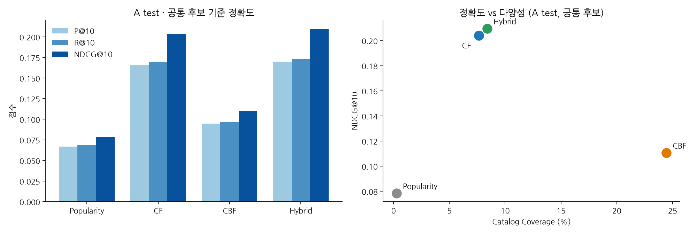
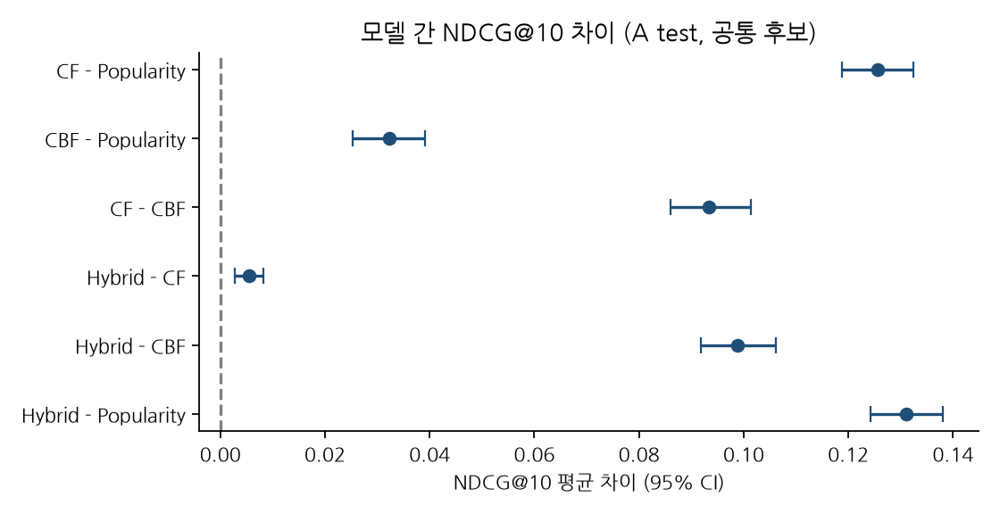

# Last.fm 아티스트 추천 시스템

사용자의 청취 기록으로 아직 듣지 않은 아티스트 Top-10을 추천하는 시스템이다. 사용자 기반 협업 필터링(CF), 태그 기반 콘텐츠 필터링(CBF), 두 방식을 합친 하이브리드(가중 RRF)를 구현하고 인기순 기준선과 같은 기준으로 비교한다.

가천대학교 머신러닝 2분반 팀 프로젝트 (2조)

## 1. 개요

| 모델 | 설명 |
|---|---|
| 인기순 (Popularity) | 개인화 없이 서로 다른 청취자 수가 많은 순으로 추천하는 기준선 |
| 협업 필터링 (CF) | 코사인 유사도 기반 User-based CF (k=30, log1p 재생 횟수 가중) |
| 콘텐츠 기반 필터링 (CBF) | 아티스트 태그의 TF-IDF 벡터와 사용자 취향 프로필의 코사인 유사도 |
| 하이브리드 | CF와 CBF의 Top-50 순위를 가중 Reciprocal Rank Fusion으로 결합 (w=0.9, c=60) |

평가 지표는 Precision@10, Recall@10, NDCG@10, 카탈로그 Coverage이다. 정확도 외에 인기도 편향, 사용자 활동량별 성능, 두 모델의 보완성, bootstrap 신뢰구간과 반복 재표집으로 결과의 안정성을 확인했다.

## 2. 데이터

| 구분 | 데이터 | 용도 |
|---|---|---|
| Dataset A | [HetRec 2011 Last.fm 2K](https://grouplens.org/datasets/hetrec-2011/) (사용자 1,892명, 청취 기록 92,834건, 아티스트 태그 포함) | 모델 개발, 설정 선택, 내부 평가 |
| Dataset B | [Last.fm 360K](https://doi.org/10.5281/zenodo.6090214)에서 사용자 10,000명을 무작위 추출 (시드 42) | 외부 평가 (A에서 정한 설정이 다른 사용자 집단에서도 유지되는지 확인) |

데이터 파일은 이 저장소에 포함하지 않는다. 위 링크에서 직접 내려받아 전처리 스크립트로 변환한다. B는 A와 같은 Last.fm에서 수집되어 완전히 독립적인 도메인은 아니며, 두 데이터셋의 사용자 ID는 서로 연결하지 않았다.

## 3. 폴더 구조

```
.
├─ 01_preprocessing/
│  ├─ preprocess_lastfm_2k_2.py        Dataset A 전처리
│  └─ preprocess_lastfm_360k_1.py      Dataset B 전처리 (A와 아티스트 연결)
├─ notebooks/
│  ├─ ML_CollaborativeFiltering.ipynb  협업 필터링
│  ├─ ML_ContentBasedFiltering.ipynb   콘텐츠 기반 필터링
│  ├─ 03_Hybrid_Filtering.ipynb        하이브리드 (.py 버전 포함)
│  ├─ 04_Integration_Evaluation.ipynb  4개 모델 통합 평가 (.py 버전 포함)
│  ├─ data/                            전처리 ZIP을 두는 곳 (저장소에는 포함하지 않음)
│  ├─ cf_outputs/                      CF 결과
│  ├─ cbf_outputs/                     CBF 결과
│  ├─ hybrid_outputs/                  하이브리드 결과 (04의 입력)
│  └─ integration_outputs/             통합 평가 표와 그림
└─ docs/                               보고서 문서
```

## 4. 실행 방법

실행 순서는 전처리 → CF → CBF → 하이브리드(03) → 통합 평가(04)이다.

### 4.1 환경

```bash
pip install -r requirements.txt
```

Python 3, numpy, pandas, scipy, scikit-learn, matplotlib을 사용한다. 전처리 스크립트는 표준 라이브러리만 사용한다.

### 4.2 전처리

A를 먼저 실행한 뒤 B를 실행한다. B의 `--a-output`에는 A의 결과 폴더를 지정한다. 출력 폴더는 비어 있어야 한다.

```bash
python 01_preprocessing/preprocess_lastfm_2k_2.py \
  --input hetrec2011-lastfm-2k.zip --output data_a

python 01_preprocessing/preprocess_lastfm_360k_1.py \
  --input lastfm-dataset-360K.tar.gz --output data_b \
  --a-output data_a --sample-users 10000
```

두 폴더의 결과를 하나의 ZIP으로 묶어 `notebooks/data/`에 둔다. ZIP 안에는 `Lastfm.2k-a/`와 `Lastfm.360k-b/` 폴더가 있어야 한다.

### 4.3 모델 노트북

1. `ML_CollaborativeFiltering.ipynb`, `ML_ContentBasedFiltering.ipynb`를 실행한다. 전처리 ZIP을 업로드하는 방식(Google Colab)으로 실행했고 결과는 `cf_outputs/`, `cbf_outputs/`에 저장된다.
2. `03_Hybrid_Filtering.ipynb`를 실행한다. 노트북이 있는 폴더 또는 그 아래 `data/`에서 ZIP을 자동으로 찾고, `cf_outputs/`, `cbf_outputs/`의 `selected_config.json`이 있으면 읽는다. 결과는 `hybrid_outputs/`에 저장된다.
3. `04_Integration_Evaluation.ipynb`를 실행한다. `hybrid_outputs/`가 필수이고 `cf_outputs/`, `cbf_outputs/`는 선택이다. 결과는 `integration_outputs/`에 저장된다.

모든 난수는 `SEED=42`로 고정했다. 04 노트북은 저장된 추천 CSV를 다시 채점하여 모델 노트북의 공식 결과와 일치하는지 확인한다.

## 5. 평가 원칙

- 설정 선택은 Dataset A의 Validation으로만 한다. CF의 k와 가중치, CBF의 TF 방식과 프로필 가중치, 하이브리드의 가중치 w 모두 A-Validation의 NDCG@10으로 정했다.
- Test는 확정된 설정의 최종 평가에만 썼다. B는 설정을 바꾸는 데 쓰지 않았다.
- 사용자 유사도, 사용자 프로필, 인기도는 train 또는 train+validation 이력으로만 계산한다.
- B에서는 모델을 다시 학습한다. B 사용자는 A에 없으므로 A의 유사도를 옮기지 않고 같은 알고리즘 구조로 B 사용자끼리 새로 계산했다.
- 사용자별로 이력을 학습 약 60%, 검증 약 20%, 테스트 약 20%로 무작위 분할한다. 청취 시각이 없어 시간순 평가가 아니다.

## 6. 주요 결과

### 6.1 공식 결과 (각 모델 노트북의 평가 조건, NDCG@10)

| 데이터 | 인기순 | CF | CBF |
|---|---|---|---|
| A (Test) | 0.0783 | 0.2039 | 0.1135 |
| B | 0.0394 | 0.1462 | 0.0831 |

### 6.2 공통 후보 기준 (4개 모델이 후보, 정답, 사용자를 공유)

| 데이터 | 모델 | NDCG@10 | Coverage |
|---|---|---|---|
| A (후보 9,444개, 사용자 1,877명) | 인기순 | 0.0783 | 0.3% |
| | CF | 0.2039 | 7.6% |
| | CBF | 0.1106 | 24.4% |
| | 하이브리드 | 0.2095 | 8.4% |
| B (후보 8,161개, 사용자 9,931명) | 인기순 | 0.0456 | 0.3% |
| | CF | 0.1690 | 30.3% |
| | CBF | 0.0847 | 43.7% |
| | 하이브리드 | 0.1718 | 31.7% |

- 하이브리드와 CF의 NDCG@10 차이는 A에서 +0.0056 (95% CI +0.0028 ~ +0.0082), B에서 +0.0028 (95% CI +0.0015 ~ +0.0042)이며 둘 다 신뢰구간이 0을 포함하지 않는다.
- CF는 인기순보다 A에서 약 2.6배, B에서 약 3.7배 높다. CBF는 CF보다 정확도가 낮지만 Coverage가 높아 덜 알려진 아티스트까지 추천한다.
- 공통 후보 기준은 CBF가 추천할 수 있는 범위로 모델을 맞춘 보조 평가이고, 모델별 기준 수치는 공식 결과이다.





전체 표와 그림은 `notebooks/integration_outputs/`에 있다 (`final_comparison.csv`, `summary.txt`, `table1~6`, `fig1~4`).

## 7. 한계

- B는 A와 같은 Last.fm 플랫폼의 다른 사용자 집단이다. 다른 도메인이나 플랫폼으로 일반화된다고 주장하지 않는다.
- A와 B의 아티스트 연결은 정규화한 이름 기준이며, 동명이인이나 별칭을 확인한 동일 인물 연결이 아니다.
- B의 콘텐츠 평가는 연결과 태그 조건을 통과한 아티스트로 제한되어 A와 직접 비교할 수 없다.
- 신뢰구간은 평가 사용자 표본에 의한 불확실성만 반영하며, 데이터 분할(시드 42 한 번)에 따른 변동은 반영하지 않는다.
- 청취 시각이 없어 무작위 hold-out 평가이다. 태그는 정적 집계 메타데이터이므로 CBF 평가는 엄밀한 시간적 평가가 아니다.

## 8. 개선 방향

- 여러 분할 시드로 전체 파이프라인을 반복하여 분할 변동까지 반영한 신뢰구간을 구한다.
- 하이브리드 가중치를 정확도와 다양성을 함께 고려하는 기준으로 선택한다.
- 모델 기반 협업 필터링(행렬 분해 등)을 추가해 비교한다.
- B의 아티스트를 MusicBrainz ID 기준으로 연결하여 CBF와 하이브리드도 B 전체 조건에서 평가한다.
- 다른 도메인(예: 영화) 데이터에 같은 평가 틀을 적용한다.

## 9. 팀원

| 이름 | 담당 |
|---|---|
| 김강호 | 데이터 전처리 |
| 안세림 | 협업 필터링 (CF) |
| 오승근 | 콘텐츠 기반 필터링 (CBF) |
| 황민우 | 하이브리드 필터링, 모델 평가와 결과 통합 |

## 10. 참고 문헌

- Cormack, G. V., Clarke, C. L. A., & Büttcher, S. (2009). Reciprocal rank fusion outperforms Condorcet and individual rank learning methods. SIGIR '09.
- Herlocker, J. L., Konstan, J. A., Borchers, A., & Riedl, J. (1999). An algorithmic framework for performing collaborative filtering. SIGIR '99.
- Salton, G., & Buckley, C. (1988). Term-weighting approaches in automatic text retrieval. Information Processing & Management, 24(5).
- Järvelin, K., & Kekäläinen, J. (2002). Cumulated gain-based evaluation of IR techniques. ACM TOIS, 20(4).
- Efron, B. (1979). Bootstrap methods: Another look at the jackknife. The Annals of Statistics, 7(1).
- Cantador, I., Brusilovsky, P., & Kuflik, T. (2011). 2nd Workshop on Information Heterogeneity and Fusion in Recommender Systems (HetRec 2011). RecSys '11.
- Celma, Ò. (2010). Music Recommendation and Discovery. Springer. (Last.fm 360K)

## 11. 라이선스

코드와 문서에는 MIT License를 적용한다. 데이터셋은 각 제공처의 이용 조건을 따른다.
