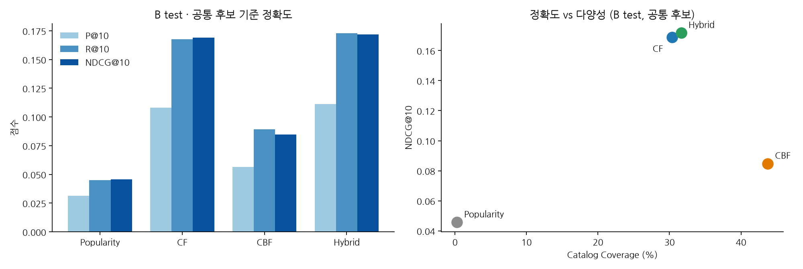

# Last.fm Artist Recommender

A system that recommends the top 10 artists a user has not listened to yet, based on listening history. It implements user-based collaborative filtering (CF), tag-based content-based filtering (CBF), and a hybrid of the two (weighted RRF), and compares them with a popularity baseline under the same evaluation protocol.

Machine Learning term project, Gachon University (Section 2, Team 2)

## 1. Overview

| Model | Description |
|---|---|
| Popularity | Non-personalized baseline that recommends artists with the most distinct listeners |
| Collaborative filtering (CF) | User-based CF with cosine similarity (k=30, log1p play-count weighting) |
| Content-based filtering (CBF) | Cosine similarity between TF-IDF artist tag vectors and a user taste profile |
| Hybrid | Combines the top-50 rankings of CF and CBF with weighted Reciprocal Rank Fusion (w=0.9, c=60) |

Evaluation metrics are Precision@10, Recall@10, NDCG@10, and catalog coverage. Beyond accuracy, we examine popularity bias, performance by user activity level, and the complementarity of the two models, and we check the stability of the results with bootstrap confidence intervals and repeated resampling.

## 2. Data

| Dataset | Source | Role |
|---|---|---|
| Dataset A | [HetRec 2011 Last.fm 2K](https://grouplens.org/datasets/hetrec-2011/) (1,892 users, 92,834 listening records, artist tags) | Model development, setting selection, internal evaluation |
| Dataset B | 10,000 users randomly sampled from [Last.fm 360K](https://doi.org/10.5281/zenodo.6090214) (seed 42) | External evaluation (checks whether settings chosen on A hold for a different user population) |

The data files are not included in this repository. Download them from the links above and convert them with the preprocessing scripts. Dataset B comes from the same platform (Last.fm) as A, so it is not a fully independent domain, and user IDs of the two datasets are not linked.

## 3. Repository Structure

```
.
├─ 01_preprocessing/
│  ├─ preprocess_lastfm_2k_2.py        Dataset A preprocessing
│  └─ preprocess_lastfm_360k_1.py      Dataset B preprocessing (links artists to A)
├─ notebooks/
│  ├─ ML_CollaborativeFiltering.ipynb  Collaborative filtering
│  ├─ ML_ContentBasedFiltering.ipynb   Content-based filtering
│  ├─ 03_Hybrid_Filtering.ipynb        Hybrid
│  ├─ 04_Integration_Evaluation.ipynb  Unified evaluation of the four models
│  ├─ data/                            Place the preprocessed ZIP here (not included in the repository)
│  ├─ cf_outputs/                      CF results
│  ├─ cbf_outputs/                     CBF results
│  ├─ hybrid_outputs/                  Hybrid results (input of notebook 04)
│  └─ integration_outputs/             Unified evaluation tables and figures
└─ docs/                               Reports
```

## 3.1 Documents

- [Report: Source Codes & Descriptions](docs/ML_Term_Project_Team2_Report.docx): preprocessing, CF, CBF, hybrid, evaluation, results, and limitations (English).
- The notebooks and preprocessing scripts are annotated in Korean (code comments and printed messages). The report and this README are in English.

## 4. How to Run

Run the steps in this order: preprocessing, CF, CBF, hybrid (03), unified evaluation (04).

### 4.1 Environment

```bash
pip install -r requirements.txt
```

The project uses Python 3, numpy, pandas, scipy, scikit-learn, and matplotlib. The preprocessing scripts use only the standard library.

### 4.2 Preprocessing

Run A first, then B. Pass A's output folder to `--a-output` of B. Output folders must be empty.

```bash
python 01_preprocessing/preprocess_lastfm_2k_2.py \
  --input hetrec2011-lastfm-2k.zip --output data_a

python 01_preprocessing/preprocess_lastfm_360k_1.py \
  --input lastfm-dataset-360K.tar.gz --output data_b \
  --a-output data_a --sample-users 10000
```

Bundle the results of the two folders into one ZIP and place it in `notebooks/data/`. The ZIP must contain the folders `Lastfm.2k-a/` and `Lastfm.360k-b/`. See `notebooks/data/README.md` for details.

### 4.3 Model notebooks

1. Run `ML_CollaborativeFiltering.ipynb` and `ML_ContentBasedFiltering.ipynb`. They were run in Google Colab by uploading the preprocessed ZIP, and results are saved to `cf_outputs/` and `cbf_outputs/`.
2. Run `03_Hybrid_Filtering.ipynb`. It finds the ZIP automatically in the notebook folder or its `data/` subfolder, and reads `selected_config.json` from `cf_outputs/` and `cbf_outputs/` if present. Results are saved to `hybrid_outputs/`.
3. Run `04_Integration_Evaluation.ipynb`. `hybrid_outputs/` is required; `cf_outputs/` and `cbf_outputs/` are optional. Results are saved to `integration_outputs/`.

All random seeds are fixed to `SEED=42`. Notebook 04 re-scores the saved recommendation CSVs and checks that they match the official results of the model notebooks.

## 5. Evaluation Principles

- Settings are selected only on the validation split of Dataset A. The CF neighborhood size k and weighting, the CBF TF mode and profile weighting, and the hybrid weight w are all chosen by NDCG@10 on A-validation.
- The test split is used only for the final evaluation of the chosen settings. Dataset B is never used to change settings.
- User similarity, user profiles, and popularity are computed only from the train (or train+validation) history.
- Models are retrained on B. B users do not appear in A, so A's similarities are not transferred; the same algorithm is recomputed among B users.
- Each user's history is randomly split into about 60% train, 20% validation, and 20% test. The data has no timestamps, so this is not a temporal evaluation.

## 6. Main Results

### 6.1 Official results (evaluation conditions of each model notebook, NDCG@10)

| Dataset | Popularity | CF | CBF |
|---|---|---|---|
| A (test) | 0.0783 | 0.2039 | 0.1135 |
| B | 0.0394 | 0.1462 | 0.0831 |

### 6.2 Common-candidate evaluation (the four models share candidates, ground truth, and users)

| Dataset | Model | NDCG@10 | Coverage |
|---|---|---|---|
| A (9,444 candidates, 1,877 users) | Popularity | 0.0783 | 0.3% |
| | CF | 0.2039 | 7.6% |
| | CBF | 0.1106 | 24.4% |
| | Hybrid | 0.2095 | 8.4% |
| B (8,161 candidates, 9,931 users) | Popularity | 0.0456 | 0.3% |
| | CF | 0.1690 | 30.3% |
| | CBF | 0.0847 | 43.7% |
| | Hybrid | 0.1718 | 31.7% |

- The NDCG@10 difference between the hybrid and CF is +0.0056 on A (95% CI +0.0028 to +0.0082) and +0.0028 on B (95% CI +0.0015 to +0.0042). Both confidence intervals exclude zero.
- CF is about 2.6 times better than popularity on A and about 3.7 times on B. CBF is less accurate than CF but has higher coverage, so it recommends less well-known artists.
- The common-candidate setting is a supplementary evaluation that restricts all models to what CBF can recommend. The per-model reference numbers are the official results.





Full tables and figures are in `notebooks/integration_outputs/` (`final_comparison.csv`, `summary.txt`, `table1` to `table6`, `fig1` to `fig4`).

## 7. Limitations

- Dataset B is a different user population from the same platform (Last.fm). We do not claim generalization to other domains or platforms.
- Artist links between A and B are based on normalized names. They are not verified identity matches, so homonyms and aliases may remain.
- B's content-based evaluation is restricted to artists that pass the link and tag conditions, so it is not directly comparable with A.
- Confidence intervals reflect only uncertainty from the evaluation user sample, not variation from the data split (a single seed of 42).
- The data has no timestamps, so evaluation is a random hold-out. Tags are static aggregated metadata, so the CBF evaluation is not a strict temporal evaluation.

## 8. Future Work

- Repeat the whole pipeline with multiple split seeds to obtain confidence intervals that include split variation.
- Select the hybrid weight with a criterion that considers both accuracy and diversity.
- Add and compare a model-based collaborative filtering method such as matrix factorization.
- Link B artists by MusicBrainz ID so that CBF and the hybrid can be evaluated under B's full conditions.
- Apply the same evaluation framework to data from another domain, such as movies.

## 9. Team

| Name | Responsibility |
|---|---|
| Kim Kangho | Data preprocessing |
| An Serim | Collaborative filtering (CF) |
| Oh Seunggeun | Content-based filtering (CBF) |
| Hwang Minwoo | Hybrid filtering, model evaluation and result integration |

## 10. References

- Cormack, G. V., Clarke, C. L. A., & Büttcher, S. (2009). Reciprocal rank fusion outperforms Condorcet and individual rank learning methods. SIGIR '09.
- Herlocker, J. L., Konstan, J. A., Borchers, A., & Riedl, J. (1999). An algorithmic framework for performing collaborative filtering. SIGIR '99.
- Salton, G., & Buckley, C. (1988). Term-weighting approaches in automatic text retrieval. Information Processing & Management, 24(5).
- Järvelin, K., & Kekäläinen, J. (2002). Cumulated gain-based evaluation of IR techniques. ACM TOIS, 20(4).
- Efron, B. (1979). Bootstrap methods: Another look at the jackknife. The Annals of Statistics, 7(1).
- Cantador, I., Brusilovsky, P., & Kuflik, T. (2011). 2nd Workshop on Information Heterogeneity and Fusion in Recommender Systems (HetRec 2011). RecSys '11.
- Celma, Ò. (2010). Music Recommendation and Discovery. Springer. (Last.fm 360K)

## 11. License

The code and documents are released under the MIT License. The datasets follow the terms of their respective providers.
